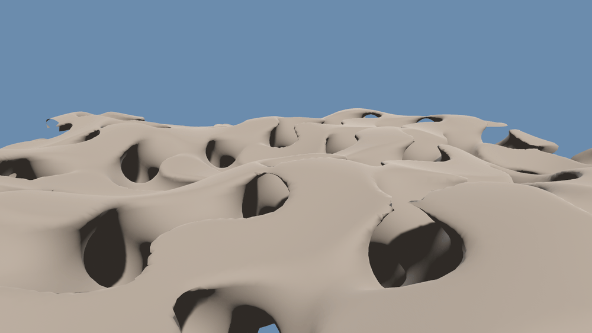
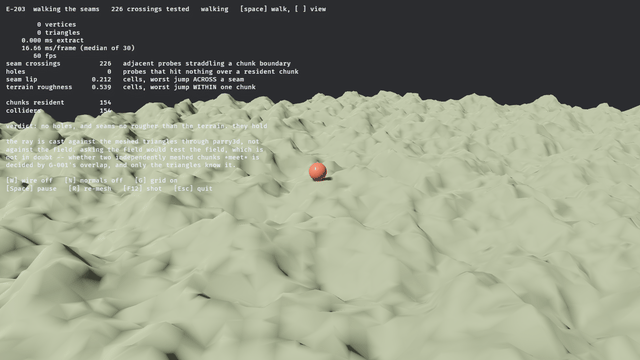
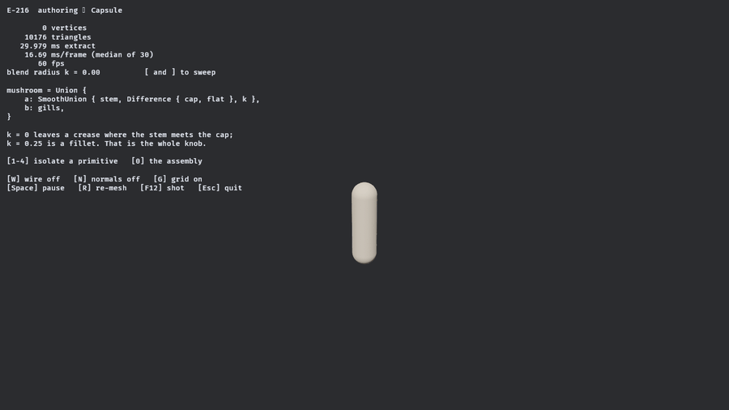
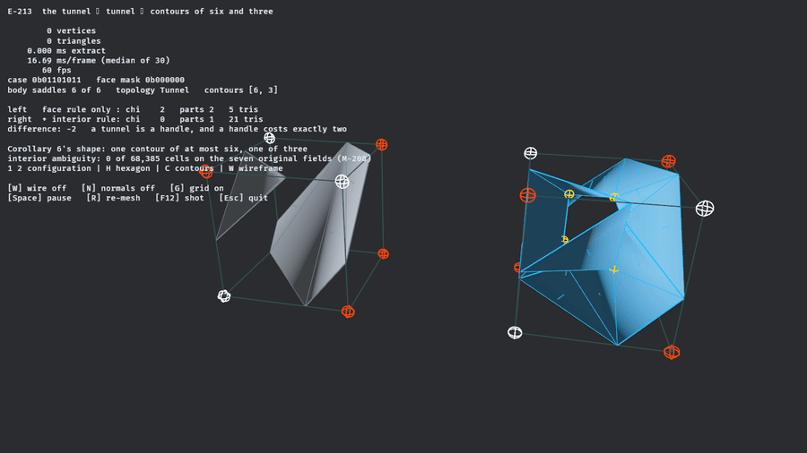
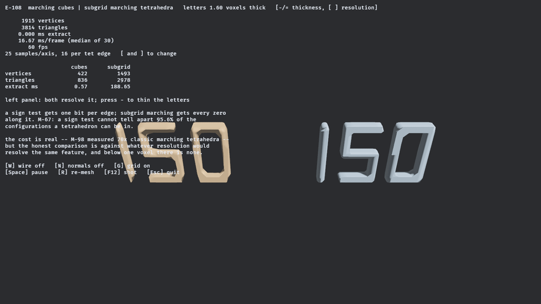

# What it can do, shown

Moved from the root README on 2026-10-31, with its link paths updated and stale Bevy versions corrected, when the README was brought to the [org documentation guide](https://github.com/bevy-coven/.github/blob/main/DOCUMENTATION.md).

## You cannot store this as a height



*A camera flying **through** the rock — under arches, into tunnels, out the far side. 440,000 triangles
across 376 streamed chunks at 60 fps, meshed while the camera moved.*

The field is nine lines and nothing in it is authored:

```text
solid(p) = max( p.y − height(x, z) ,  |gyroid(p)| − thickness )
```

A `max` is an intersection, so rock exists only where a point is **below the terrain surface** *and*
**inside a thickened gyroid**. The gyroid is triply periodic — it tunnels in `x`, `y` and `z` by
construction — so the result has caves that connect, arches carrying rock over open ground, and
ceilings.

A heightfield stores one number per column. It cannot represent any of those, which is the entire
reason to reach for a voxel mesher instead of a quadtree of grids.

```bash
cd bevy_isomesh && cargo run --example game_showcase --release
```


## 495 seam crossings, zero holes



*Nothing here is pre-baked. Every chunk under that ball was extracted while the camera flew toward it,
on a background thread, under a frame budget — and the ball is standing on the **triangles**, not on the
field they came from.*

That last part is the whole test. Chunks are meshed independently, so whether two of them actually
*meet* is decided by the overlap the chunk layout chose. Get it wrong and a player falls through the
world at a boundary — a bug that is invisible in every screenshot and fatal in every playthrough.

So the demo counts rather than asserts. It casts a dense transect of rays straight down against the
meshed triangles, every frame, through `parry3d`:

| | |
|---|---|
| seam crossings tested | **495** |
| probes that hit nothing | **0** |
| worst vertical step **across** a seam | **0.412 cells** |
| worst vertical step **within** one chunk | **0.539 cells** |

The seams are measurably smoother than the terrain they join. That comparison is the point — a fixed
height threshold would have been measuring the landscape rather than the joins.

Meanwhile the frame time does not move: **60 fps at 16.65 ms/frame** with 234 chunks resident and
117,792 triangles, while chunks load and unload continuously. Meshing runs on the task pool; what the
frame budget bounds is turning finished extractions into assets.

```bash
cd bevy_isomesh && cargo run --example game_walk --release
```

## Building the field, not meshing it



*Every other example here starts from a field that already exists. This one has no meshing content at
all: the extractor is the default and the only thing that changes is the expression. Left, the four
primitives. Right, `Union { SmoothUnion { stem, Difference { cap, flat }, k }, gills }`. **`k` is the
knob a level designer reaches for** — at zero the stem meets the cap in a crease, and by 0.25 it is a
fillet — and `[` and `]` sweep it and re-mesh while the triangle count and extraction time update.*

## One cell, meshed twice



*Marching Cubes 33's interior ambiguity, which is the hardest thing in this repository and the easiest
to show once the surfaces are filled rather than drawn as outlines. **Left** the face rule alone: two separate discs, two components, χ = 2. **Right** the same
cell with the interior rule: one cylinder through it, one component, χ = 0. A tunnel is a handle and a
handle costs exactly two — the difference is arithmetic, not a matter of opinion, and the HUD reports
it every frame. The gold ring is the inner hexagon: six body saddles of the trilinear interpolant,
the points Grosso's whole construction is built from.*


## Marching Cubes returns 0 triangles here. Subgrid returns 1,340.



*One field, one grid, two extractors, and a sweep driving the letters from 1.6 voxels thick down to
0.2. Left, Marching Cubes: first a scatter, then nothing. Right, subgrid Marching Tetrahedra,
unchanged.*

A feature thinner than a voxel does not exist to a method that asks *"what sign is this grid corner"* —
one bit per edge, and a thin sheet fits between the samples. **M-67** puts a number on the gap: a sign
test cannot distinguish **95.6%** of the configurations a tetrahedron can actually be in.

`isomesh` ships **subgrid Marching Tetrahedra**, which asks instead for *every zero along the edge*. On
letters 0.35 voxels thick, Marching Cubes returns **0** triangles and subgrid returns **1,340** — on the
same grid, at any resolution you like.

[The measured version, on the algorithms page →](../demos/algorithms.md)

---
